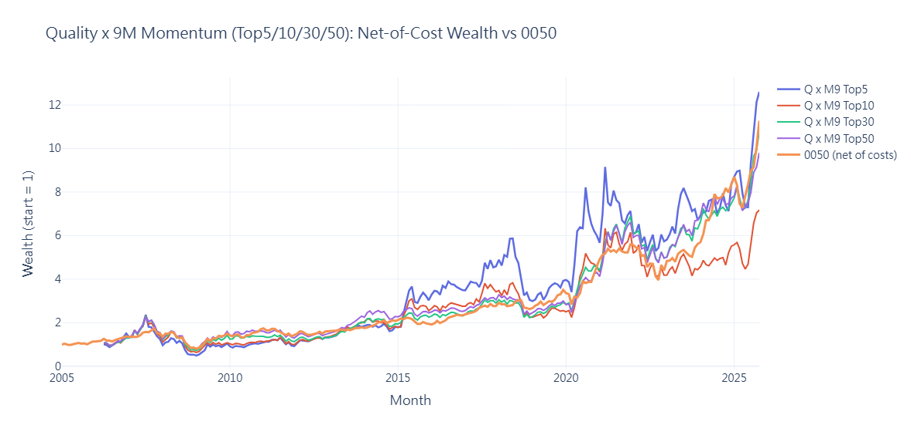
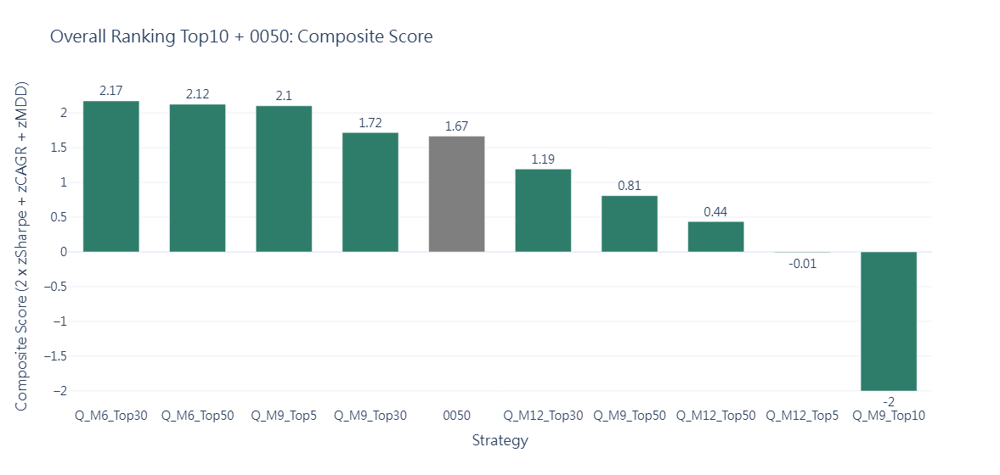

# Taiwan Stock Quality x Momentum

A monthly backtest of a quality-filtered momentum strategy on Taiwan-listed stocks (2005-2025), net of transaction costs and compared against the 0050 ETF.

Built during a quant internship, before my master's thesis ([taiwan-stock-sofar-ml](https://github.com/PeggyWu336/taiwan-stock-sofar-ml)). The main finding is a negative one: no default specification beats 0050 on a risk-adjusted basis. Several look-ahead issues I identified later are documented in [Known limitations](#known-limitations).

## Strategy

Each month:

1. **Universe**: keep stocks with free float >= 40%, and market cap and average turnover above the 30th percentile of that month.
2. **Quality**: compute a cross-sectional z-score for 8 financial-statement metrics and average them. Higher is better for ROA, diluted EPS, current ratio, operating cash flow, gross margin and asset turnover; lower is better for debt ratio and weighted-average shares outstanding (dilution). Keep the top 30% by quality score.
3. **Momentum**: rank the remaining stocks by 6-, 9- or 12-month price momentum.
4. **Portfolio**: buy the top N (5, 10, 30 or 50), equal weight. The signal is formed at month-end t and held during month t+1.
5. **Costs**: 0.1425% commission on buys and sells, plus 0.3% transaction tax on sells, applied to turnover estimated from weight changes.

This gives 12 strategies (3 momentum windows x 4 portfolio sizes), named like `Q_M9_Top5`.

## Results

Net of costs, default parameters. Sharpe ratio is computed without a risk-free rate.

| Strategy | Months | CAGR | Volatility | Sharpe | Max drawdown |
|---|---|---|---|---|---|
| **0050 (benchmark)** | 249 | 12.38% | 18.42% | **0.73** | **-53.96%** |
| Q_M6_Top5 | 238 | 9.23% | 39.61% | 0.41 | -77.95% |
| Q_M6_Top10 | 238 | 9.68% | 30.88% | 0.45 | -73.07% |
| Q_M6_Top30 | 238 | 13.61% | 25.60% | 0.63 | -66.35% |
| Q_M6_Top50 | 238 | 13.26% | 23.79% | 0.64 | -65.30% |
| Q_M9_Top5 | 235 | **13.82%** | 36.61% | 0.53 | -79.51% |
| Q_M9_Top10 | 235 | 10.59% | 30.70% | 0.48 | -72.82% |
| Q_M9_Top30 | 235 | 12.92% | 25.08% | 0.61 | -68.76% |
| Q_M9_Top50 | 235 | 12.37% | 23.54% | 0.62 | -64.41% |
| Q_M12_Top5 | 232 | 12.23% | 36.54% | 0.50 | -77.33% |
| Q_M12_Top10 | 232 | 9.68% | 29.55% | 0.46 | -70.20% |
| Q_M12_Top30 | 232 | 12.63% | 24.76% | 0.61 | -67.24% |
| Q_M12_Top50 | 232 | 12.13% | 23.29% | 0.61 | -63.54% |





Composite score = 2 x z(Sharpe) + z(CAGR) + z(-MDD), standardized across the 12 strategies and 0050.

### Sub-period check: Q_M9_Top5 vs 0050

| Period | Strategy CAGR | 0050 CAGR | Strategy Sharpe | 0050 Sharpe |
|---|---|---|---|---|
| 2005-2009 | 1.09% | 8.59% | 0.27 | 0.47 |
| 2010-2014 | 11.61% | 6.79% | 0.60 | 0.54 |
| 2015-2019 | 16.82% | 10.95% | 0.63 | 0.94 |
| 2020-2025 | 22.15% | 22.19% | 0.69 | 1.05 |

### Tuned specification

The top-ranked combination in the parameter grid (free float >= 40%, market cap above the 30th percentile, turnover above the 50th percentile, top 15% by quality) gives Q_M9_Top5 a CAGR of 20.86%, a Sharpe of 0.69 and a max drawdown of -66.94%. Its Sharpe is still below 0050's 0.73, and its sub-period results are even less stable:

| Period | CAGR | Sharpe | Max drawdown | 0050 Sharpe |
|---|---|---|---|---|
| 2005-2009 | 30.3% | 0.76 | -66.9% | 0.47 |
| 2010-2014 | 11.3% | 0.59 | -36.5% | 0.54 |
| 2015-2019 | -3.4% | -0.05 | -49.7% | 0.94 |
| 2020-2025 | 49.8% | 1.13 | -25.5% | 1.05 |

Even the best combination out of 486 loses money over a full five-year period (2015-2019). To reproduce, set `TURNOVER_PCT = 0.5` and `QUALITY_TOP_PCT = 0.15` at the top of the script and rerun.

### Takeaways

- **No strategy beats 0050 on Sharpe ratio or drawdown.** The best CAGR (Q_M9_Top5) is about 1.4 percentage points per year above 0050, with roughly twice the volatility and a -80% drawdown.
- **The edge is not stable over time.** Q_M9_Top5 has a higher Sharpe than 0050 in only one of four sub-periods.
- **The full-period result depends on the end date.** Q_M9_Top5 is roughly level with 0050 through 2024 and pulls ahead only in the last few months of 2025.
- **Parameter search does not rescue it.** A grid over free-float, market-cap, turnover and quality thresholds (81 settings x 6 strategies = 486 combinations) produced only 1 combination with a higher Sharpe than 0050, so tuning the filters does not create a reliable edge.

## Known limitations

This project was completed before my master's thesis. While working on the thesis, I identified the following issues in this pipeline. I am documenting them here rather than silently fixing them.

1. **Financial statement timing (look-ahead).** Quarterly fundamentals are matched to each month by quarter-end date, not by announcement date. In Taiwan, quarterly reports are published weeks to months after quarter-end, so the backtest uses information before it was public.
2. **Free float timing (look-ahead).** Each year's free-float ratio is taken from the year-end value and applied to every month of that same year.
3. **Monthly return definition.** Monthly returns are computed from the first to the last trading day's close within each month, which omits the return from the previous month-end to the first trading day.
4. **Selection bias in the parameter grid.** Picking the best of 486 combinations overstates expected performance; the grid is reported here only to show how few combinations beat the benchmark.
5. **Different sample start.** Strategies start later than 0050 (232-238 vs 249 months) because momentum needs 6-12 months of history.
6. **Cost model.** Only commission and tax are included; slippage and market impact are not, which matters most for the concentrated Top5 portfolios.

## Data

Data comes from TEJ (Taiwan Economic Journal) and is **not included** in this repository due to licensing.

- Daily stock prices, market cap, turnover and volume, aggregated to a monthly panel
- Quarterly financial statements (8 metrics listed above)
- Yearly free-float ratios
- 0050 monthly adjusted close prices (benchmark)

Sample period: 2005-01 to 2025-10.

Universe: common stocks only, excluding TDRs and KY-listed companies.

## Repository structure

```
quality_momentum_backtest.py      Backtest, ranking, parameter grid, sub-periods
sql/01_monthly_panel.sql          Daily -> monthly panel, free float (SQLite)
sql/02_quarterly_fundamentals.sql Attach quarterly fundamentals to monthly panel
images/                           Charts used in this README
```

## How to run

1. Build `monthly_panel` with the SQL scripts (run 01 once per year, then 02), and export it to `data/monthly_panel.csv`.
2. Save 0050 monthly prices as `data/0050_monthly.csv` (columns: `ym`, `close`).
3. Install dependencies: `pip install pandas numpy plotly`
4. Run `quality_momentum_backtest.py` in a Jupyter or Colab environment (the script uses `display()`).
